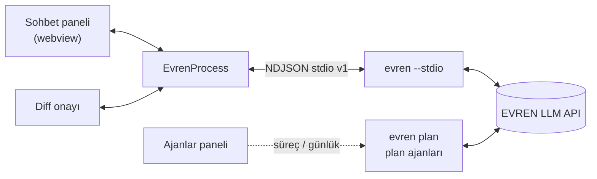

<div align="center">


# Evren for VS Code

**EVREN CLI için kenar çubuğu sohbet paneli: akan yanıt, araç kartları, diff ile onay, oturumlar ve plan ajanları.**

[](https://github.com/necmettincimen/evren-vscode/actions/workflows/ci.yml)
[](https://github.com/necmettincimen/evren-vscode/releases)
[](https://marketplace.visualstudio.com/items?itemName=necmettincimen.evren-vscode)
[](https://sonarcloud.io/summary/new_code?id=necmettincimen_evren-vscode)
[](https://github.com/necmettincimen/evren-vscode/actions/workflows/codeql.yml)
[](https://scorecard.dev/viewer/?uri=github.com/necmettincimen/evren-vscode)
[](LICENSE)

[Kurulum](#-kurulum) · [evren-cli](https://github.com/necmettincimen/evren-cli) ·
[Protokol](https://github.com/necmettincimen/evren-cli/blob/master/docs/stdio-protocol.md) ·
[Değişiklikler](CHANGELOG.md) · [English](#english-summary)

</div>

Eklenti LLM'e kendisi bağlanmaz. `evren --stdio` sürecini başlatır ve
[stdio protokolü v1](https://github.com/necmettincimen/evren-cli/blob/master/docs/stdio-protocol.md) ile konuşur.
Ajan mantığı, model erişimi ve anahtarlar CLI'da kalır.

<!-- Ekran görüntüsü / GIF: media/demo.gif eklendiğinde aşağıdaki satırı açın. -->
<!-- <p align="center"></p> -->

| | |
|---|---|
| 💬 **Sohbet paneli** | Akan markdown yanıt, düşünme akışı, araç kartları, yapılacaklar |
| ✅ **Onay ve diff** | Değişiklik `vscode.diff` ile açılır; düzenleyerek kabul, ret, her zaman izin |
| 🧭 **Ajanlar paneli** | Makinedeki Evren süreçleri ve plan ajanı günlükleri, onaylı sonlandırma |
| 🔁 **Oturumlar** | Geçmiş, devam etme, kip ve model seçimi |
| 🔒 **Anahtarsız eklenti** | Anahtarlar CLI'da kalır; eklenti ayarlarına yazılmaz |



## ✨ Özellikler

- Akan yanıt (`assistant_delta`, markdown) ve katlanabilir düşünme (`reasoning_delta`)
- Araç kartları: ad, kısa argüman, çalışıyor / tamam / hata, genişletilebilir çıktı
- Dosya değişikliği: `file_change_proposed` gelince `vscode.diff` açılır (sol mevcut, sağ önerilen).
  Sağ taraf düzenlenebilir; kabul edilince düzenlenmiş metin `edited_content` olarak gider.
  Panelde ve diff başlığında Kabul / Reddet / Her zaman izin ver
- Komut / ssh onayı: komut metni panelde gösterilir
- `ask_user` soru kartı (seçenek düğmeleri ya da serbest metin), yapılacaklar paneli (`todos`)
- Durdur (`cancel`, Esc), yeni oturum, oturum geçmişi ve `resume`, model ve kip seçimi
- Durum çubuğunda model · kip · token
- `@` ile dosya seçici, `Ctrl+Alt+K` seçimi `@yol#L10-20` olarak ekler
- stderr ve süreç günlüğü **Evren** çıktı kanalında (`Evren: Show Logs`)
- **Ajanlar** paneli (Evren kenar çubuğunda, sohbetin altında): makinede çalışan Evren süreçleri
  (`evren plan`, başsız `-p` ajanları, stdio sohbetleri, etkileşimli oturumlar) plan → ajan ağacı olarak;
  model, süre, çalışma dizini, istemin tamamı ipucunda. Satırdan istemi kopyala / sonlandır (onaylı,
  alt süreçlerle birlikte; bu pencerenin süreci korunur). `reports/agent-logs/*.log` günlükleri son
  satırıyla listelenir, son 90 sn'de yazılan "aktif" sayılır, tıklayınca sonuna gidilerek açılır.
  Panel görünürken 5 sn'de bir yenilenir, rozet çalışan ajan sayısını gösterir.

## 🚀 Kurulum

Önkoşul: EVREN CLI ≥ 3.10.0 PATH'te olmalı (`evren --version`). Eski bir sürüm kuruluysa eklenti güncelleme uyarısı verir.

```bash
pip install "evren-cli @ git+https://github.com/necmettincimen/evren-cli"
```

1. [Releases](https://github.com/necmettincimen/evren-vscode/releases) sayfasından `evren-vscode-X.Y.Z.vsix` dosyasını indirin.
2. VS Code'da *Extensions: Install from VSIX…* komutunu çalıştırın. Komut satırından `code --install-extension evren-vscode-X.Y.Z.vsix` de kullanılabilir.
3. Kenar çubuğundaki Evren simgesine tıklayın.

Kaynaktan geliştirmek için `npm ci && npm run compile` çalıştırın ve VS Code'da **F5** tuşuna basın (Extension Development Host).

## ⚙️ Ayarlar

| ayar | varsayılan | anlam |
|---|---|---|
| `evren.cliPath` | `evren` | çalıştırılabilir dosya (ad ya da tam yol; `.cmd`/`.bat` desteklenir) |
| `evren.pythonPath` | — | doluysa `<python> -m src.cli --stdio` kullanılır |
| `evren.cliRepo` | — | `pythonPath` ile birlikte evren-cli kaynak dizini |
| `evren.model` | — | başlangıç modeli |
| `evren.defaultMode` | `normal` | `normal` / `plan` / `ask` |
| `evren.autoApprove` | `none` | `edits`: düzenleme araçları onaysız; `all`: `--yes` |
| `evren.allowedTools` | `[]` | `--allowed-tools` listesi |
| `evren.extraEnv` | `{}` | sürece eklenecek ortam değişkenleri (API anahtarı yazmayın) |
| `evren.autoAttachActiveFile` | `false` | her isteğe aktif dosyayı ekle |

API anahtarları ayarlara yazılmaz; CLI kendi yapılandırmasını (`~/.evren`, `secret_vault`) kullanır.

## ⌨️ Komutlar

`Evren: Open Chat`, `New Session`, `Resume Session`, `Add Selection to Chat`, `Cancel`,
`Select Model`, `Select Mode`, `Restart CLI`, `Show Logs`, `Ajanları yenile`.

## 🔗 Protokol sürüm uyumu

- Eklenti `v: 1` mesajları gönderir ve yalnız `v: 1` olayları işler; tanımadığı olay tiplerini atlar.
- `ready.version` < 3.10.0 ise süreç durdurulur ve güncelleme talimatı gösterilir.
- Süreç çökerse bekleyen onaylar ve diff sekmeleri kapatılır; panel tek tıkla yeniden başlatmayı sunar.

| evren-vscode | En düşük evren-cli | stdio protokolü |
|---|---|---|
| 0.1.x | 3.10.0 | v1 |

Sürüm politikası:

- Protokol sürümü yalnız geriye uyumsuz değişiklikte artar.
- Eklentinin en düşük CLI sürümü (`MIN_CLI_VERSION`) yalnız yeni bir CLI özelliğine ihtiyaç duyulduğunda yükselir; bu değişiklik CHANGELOG'da belirtilir.
- Sözleşme [`protocol/stdio-v1.schema.json`](protocol/stdio-v1.schema.json) dosyasıdır; [`protocol/CLI_TAG`](protocol/CLI_TAG) içindeki evren-cli etiketinden alınır.
- CI her push'ta sözleşme testini ve gerçek CLI'a karşı uyumluluk testini Ubuntu ve Windows'ta koşturur. Her evren-cli release'i de bu işi `repository_dispatch` ile tetikler.

## 🧪 Testler

```bash
npm test             # derleme, protokol istemcisi birim testleri ve şema sözleşme testi
npm run test:compat  # gerçek evren --stdio + sahte model sunucusu (LLM'siz; EVREN_BASE_URL gerekir)
npm run test:e2e     # Extension Host içinde senaryolar (LLM'li senaryolar kota harcar, ~3 dk)
```

CI'da `EVREN_E2E_ONLY=ayarlar,ajanlar` ile yalnız LLM gerektirmeyen senaryolar xvfb altında, evren-cli'nin sahte model sunucusuna karşı koşar.

`test:e2e` geçici bir git deposunda senaryoları sırayla koşar (`EVREN_E2E_ONLY=ad1,ad2` ile seçilir):

| Senaryo | Doğruladığı |
|---|---|
| `ayarlar` | `list_models`/`set_model`, kip değişimi, hatalı kip/oturum/slash hata kodları |
| `duzenleme` | diff'in sağ tarafı elle düzenlenip onaylanır, `edited_content` diske yazılır |
| `reddet` | tüm onaylar reddedilir: dosya değişmez, diff kapanır, ret modele iletilir |
| `iptal` | tur ortasında `cancel` → `turn_end` hızlı gelir, sonraki tur çalışır |
| `uygulama` | ajan sıfırdan `app/` altında Python todo CLI + unittest yazar ve test eder; testler ve CLI ayrıca dışarıdan çalıştırılır, `always` kuralının yazıldığı kontrol edilir |
| `ajanlar` | sahte başsız ajan + günlük: panelde görünür, Türkçe istem bozulmaz, günlük açılır, sonlandırma çalışır, kendi stdio süreci korunur |
| `oturumlar` | `list_sessions` / `resume` |

Kurulu VS Code'u kullanır (`VSCODE_EXE` ile değiştirilebilir).

## ❓ SSS

**Eklenti "evren CLI bulunamadı" diyor.**
`evren --version` komutunun terminalde çalıştığını kontrol edin. Çalışmıyorsa `evren.cliPath` ayarına tam yolu yazın ya da `evren.pythonPath` ile `evren.cliRepo` ayarlarını kullanın.

**API anahtarını nereye yazarım?**
Eklentiye yazmazsınız. CLI kendi yapılandırmasını (`.env`, `~/.evren`) kullanır.

**Hangi CLI sürümü gerekir?**
[Uyumluluk tablosuna](#-protokol-sürüm-uyumu) bakın.

## 🤝 Katkı

[CONTRIBUTING.md](CONTRIBUTING.md) · [CODE_OF_CONDUCT.md](CODE_OF_CONDUCT.md) · [SECURITY.md](SECURITY.md)

## 📄 Lisans

[MIT](LICENSE)

---

## English summary

**Evren for VS Code** is a sidebar chat for [EVREN CLI](https://github.com/necmettincimen/evren-cli). It provides streaming answers,
tool cards, diff-based approval with in-place editing, sessions, and an *Agents* view for running plan agents. The extension
never calls an LLM itself. It spawns `evren --stdio` and speaks a versioned NDJSON protocol, validated in CI against the CLI's
JSON Schema and a real CLI on Ubuntu and Windows. Requires evren-cli ≥ 3.10.0. MIT licensed.
